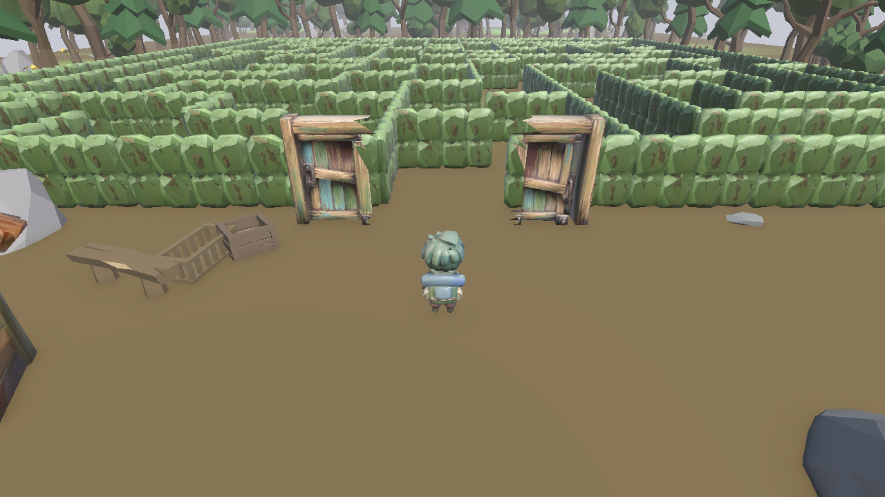
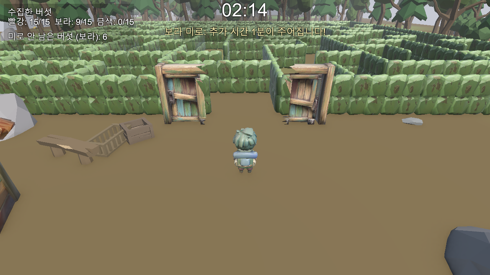
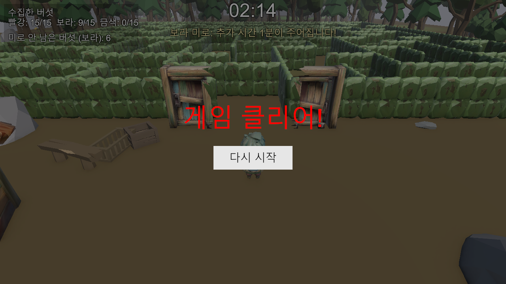

# 🍄 Shroomaze

로우폴리 3D 숲속 미로에서 색깔별 버섯을 모으는 서바이벌 수집 게임입니다. 영화 <메이즈 러너>에서 영감을 받았습니다.



## 게임 소개

허브(마당)에서 미닫이 문을 통해 미로에 들어가, 제한시간 안에 그날의 색(빨강 → 보라 → 금색) 버섯을 모으고 제한시간이 끝날 때 미로 밖에 있으면 탈출 성공입니다. 미로는 매번 재귀 백트래킹 알고리즘으로 완전히 새로 생성됩니다.

색깔별로 버섯을 **누적 15개** 모아야 그 색이 완료되며, 다 채우지 못하면 같은 색을 다시 도전하게 됩니다(이때 제한시간 +1분 보너스). 세 색 모두 완료하면 게임 클리어입니다.

## 핵심 기능

- **절차적 미로 생성** — 재귀 백트래킹 알고리즘으로 매 라운드 완전히 새로운 미로 생성
- **색깔별 누적 수집 목표** — 15개를 다 모아야 완료, 못 채운 색은 자동으로 재도전 (재도전 시 제한시간 보너스)
- **미로 안 즉시 클리어** — 목표를 다 채우면 시간이 남아도 바로 허브로 복귀, 캐릭터가 미로 안에 갇히지 않도록 자동 처리
- **실시간 타이머 기반 성공/실패 판정** — 제한시간 종료 시점에 미로 안/밖 위치로 판정
- **색깔별 수집 현황 UI** — 좌측 상단에 `빨강: 7/15` 형태로 실시간 표시
- **게임오버 / 게임 클리어 화면** — 각각 재시작 버튼 포함

## 스크린샷

| 재도전 보너스 안내 + 색깔별 UI | 게임 클리어 |
|---|---|
|  |  |

## 플레이 영상

`Submission/Movie_007.mp4` 참고 (녹화 시간을 줄이기 위해 제한시간·목표치를 임시로 낮추고 버섯을 입구 근처에 배치해서 촬영했습니다. 실제 플레이 설정은 제한시간 90초 / 색깔당 목표 15개입니다).

## 조작법

| 키 | 동작 |
|---|---|
| W / A / S / D | 이동 |
| 마우스 | 카메라는 자동으로 캐릭터를 따라감 |

## 기술 스택

- Unity 6000.6.0f1 (URP)
- C# (CharacterController 기반 이동, 코루틴 기반 상태 머신)
- Blender (3D 에셋 제작/보정)
- VARCO 3D (AI 3D 에셋 생성)
- Claude + Unity MCP (AI 코딩 에이전트로 전체 개발 진행)

## 빌드 실행

`Submission/PC_Build_Windows/Shroomaze.exe` 실행 (Windows 64비트).

## 프로젝트 구조

```
Assets/Scripts/
├── MazeGenerator.cs       # 절차적 미로 생성 (재귀 백트래킹)
├── MazeCycleManager.cs    # 허브↔미로 전체 상태 머신, 색 순환, 목표 시스템
├── PlayerController.cs    # 캐릭터 이동
├── CameraFollow.cs        # 3인칭 추적 카메라
├── GameManager.cs         # 버섯 수집 카운트/목표 관리
├── Mushroom.cs            # 버섯 수집 트리거
├── MazeTimer.cs           # 제한시간 카운트다운
├── MazeZoneTrigger.cs     # 미로 안/밖 판정
├── DoorController.cs      # 미닫이 문 애니메이션
└── GameUI.cs              # 전체 UI (타이머, 상태, 게임오버/클리어 패널)
```

## 추후 확장 계획

- 버섯이 일정 간격으로 통통 튀는 연출 추가 (카메라 구도상 시인성 개선)
- 체력(스태미나) 바와 함께 달리기(Sprint) 기능
- 정비 시간에 들를 수 있는 상점 (발자국 표시 등 탐색 보조 아이템)
- 문틀/문짝 메쉬 분리 (현재 하나의 메쉬로 합쳐져 있어 문이 열릴 때 같이 갈라지는 문제)
- BGM / 효과음

## 개발 과정

이 프로젝트는 처음부터 끝까지 Claude(AI 코딩 에이전트)와 Unity MCP(에디터 직접 제어)로 개발했습니다. 자세한 개발 로그와 AI 활용 기록은 [평가 포트폴리오 페이지](https://app.notion.com/p/401aa5b8e68f8140962ae58219c9fb4f)에 정리되어 있습니다.
